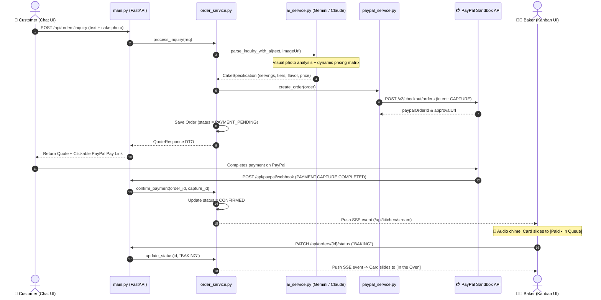

# 🧁 BakeFlow AI

> **Autonomous Order Lifecycle Management & Live Kitchen Kanban for Home Bakers**  
> *PayPal Hackathon 2026 Submission*

[](https://www.python.org/)
[](https://fastapi.tiangolo.com/)
[](https://developer.paypal.com/)
[](https://ai.google.dev/)
[](https://www.anthropic.com/)

---

## 💡 The Problem

Home bakers and artisanal cake creators are incredible culinary artists, but **they are not technical administrators**. 

Today, home bakers:
- **Lose 30–40% of their working hours** manually parsing chaotic WhatsApp and Instagram DMs.
- **Calculate custom pricing inconsistently** (forgetting to charge for extra tiers, custom fondant artwork, or dietary surcharges).
- **Face high cancellation rates** because customer slots are rarely prepaid before baking starts.
- **Constantly interrupt baking sessions** with messy flour-covered hands just to reply to *"Is my cake ready?"* texts.

---

## 🚀 The Solution: BakeFlow AI

**BakeFlow AI** is an autonomous agent system that runs the entire business lifecycle for home bakers:

1. **Multimodal Customer Ingress**: The customer sends a cake reference photo and requirements via chat (*"2-tier unicorn birthday cake for 18 guests this Saturday, eggless"*).
2. **Dual-Model Vision & Quoting Engine**: Powered by **Google Gemini** and **Anthropic Claude 3.5 Sonnet**, the agent visually analyzes the cake design, determines guest servings, calculates dynamic pricing, and composes a warm quote.
3. **PayPal Orders v2 Integration**: Instantly creates a reserved PayPal Checkout order with intent `CAPTURE` and sends a pay link to the customer.
4. **PayPal Webhooks (`PAYMENT.CAPTURE.COMPLETED`)**: Listens for verified settlement events and automatically transitions the order to `CONFIRMED`.
5. **Real-time Kitchen Kanban (SSE Stream)**: Paid orders immediately pop onto the baker's kitchen Kanban board with visual alerts—without any page refreshes!
6. **Baker Quick-Action Transitions**: The baker moves orders through `[In the Oven]` and `[Ready for Pickup]`, automatically synchronizing status updates back to the customer.

---

## 🏛️ System Architecture



---

## 📂 Project Structure

```text
baker-ai-python/
├── requirements.txt                # Production dependencies
├── .env.example                    # Sample environment template (tracked in Git)
├── .gitignore                      # Git exclusion rules (ignores .venv, .env, __pycache__)
├── main.py                         # FastAPI App & SSE streaming router
├── models.py                       # Pydantic Schemas (Order, CakeSpec, OrderStatus)
├── services/
│   ├── __init__.py                 # Package marker
│   ├── ai_service.py               # Dual AI Router (Gemini + Claude + Heuristic Fallback)
│   ├── paypal_service.py           # PayPal Orders v2 API & Sandbox Simulation
│   └── order_service.py            # Order lifecycle state machine & SSE broadcaster
├── static/                         # Interactive Split-Screen Web Interface
│   ├── index.html                  # Left: Customer Chat | Right: Kitchen Kanban
│   ├── style.css                   # Modern ambient glassmorphism styling
│   ├── app.js                      # SSE EventSource listener & client logic
│   ├── paypal-sandbox-mock.html    # Sandbox checkout simulation modal
│   └── checkout-complete.html      # Post-payment success confirmation
└── README.md
```

> [!IMPORTANT]
> **Environment Isolation & Security**:
> - **`.venv/`** is **never committed to Git**. Each developer generates their own virtual environment locally.
> - **`.env`** contains private API keys and is **never committed to Git**. Developers copy `.env.example` to create their local `.env`.
> - The included [`.gitignore`](.gitignore) automatically prevents `.venv`, `.env`, `__pycache__`, and OS metadata (`.DS_Store`) from being tracked.

---

## 🛠️ Quick Start Guide for Developers

### 1. Prerequisites
- **Python 3.11+** installed on your machine (`python3 --version`).
- A PayPal Developer account (optional for live sandbox; mock mode works out of the box).

### 2. Fork, Clone & Create Local Virtual Environment
```bash
# 1. Clone your forked repository
git clone https://github.com/<your-username>/baker-ai-python.git
cd baker-ai-python

# 2. Create an isolated virtual environment locally
python3 -m venv .venv

# 3. Activate the virtual environment
# On macOS / Linux:
source .venv/bin/activate
# On Windows (Command Prompt / PowerShell):
# .venv\Scripts\activate

# 4. Install dependencies inside your local virtual environment
pip install -r requirements.txt
```

### 3. Configure Local Environment Variables
Create your local `.env` by copying the example template:
```bash
cp .env.example .env
```

Open `.env` in your editor and configure your credentials:
```env
# PayPal Sandbox Credentials (from https://developer.paypal.com)
PAYPAL_CLIENT_ID=your_paypal_sandbox_client_id
PAYPAL_CLIENT_SECRET=your_paypal_sandbox_client_secret
PAYPAL_BASE_URL=https://api-m.sandbox.paypal.com

# AI Provider Configuration ('gemini', 'claude', or 'auto')
AI_PROVIDER=gemini

# Google Gemini API Key (from https://aistudio.google.com/)
GEMINI_API_KEY=your_gemini_api_key_here

# Anthropic Claude API Key (from https://console.anthropic.com/)
ANTHROPIC_API_KEY=your_anthropic_api_key_here
```

> [!TIP]
> **Zero-Config Fallback:** If you don't have PayPal or AI API keys yet, leave them with default values. The backend includes **built-in fail-safes** that simulate the full PayPal checkout and AI quoting offline so you can test immediately!

### 4. Run the Application
Make sure your `.venv` is activated, then start the server:
```bash
uvicorn main:app --host 0.0.0.0 --port 8000 --reload
```

Open your browser at:
👉 **`http://localhost:8000/index.html`**

---

## 🧪 Interactive Debugging (Like IntelliJ / VS Code)

If you use VS Code or Antigravity IDE:

1. Stop any running terminal server (`Ctrl + C`) so port 8000 is free.
2. Open [`main.py`](main.py) and click in the left gutter next to line 50 to place a **breakpoint (red dot)**.
3. Press **`F5`** (or go to **Run and Debug**).
4. Go to **`http://localhost:8000/index.html`** and send a cake inquiry.
5. The IDE will pause execution directly on your breakpoint, allowing you to inspect variables, view the call stack, and step through code!

---

## 📡 API Endpoints

| Method | Endpoint | Description |
| :--- | :--- | :--- |
| `POST` | `/api/orders/inquiry` | Customer sends cake text/photo $\rightarrow$ Returns structured quote + PayPal URL |
| `GET` | `/api/orders` | Retrieves all active and backlog orders for Kanban board |
| `GET` | `/api/orders/{id}` | Fetches individual order details by ID |
| `PATCH` | `/api/orders/{id}/status` | Updates order state (`BAKING`, `READY_FOR_PICKUP`, `COMPLETED`) |
| `POST` | `/api/orders/{id}/simulate-payment` | Triggers sandbox capture simulation and fires SSE broadcast |
| `POST` | `/api/paypal/webhook` | Listens for PayPal `PAYMENT.CAPTURE.COMPLETED` events |
| `GET` | `/api/kitchen/stream` | Server-Sent Events (SSE) stream for live Kanban screen synchronization |

---

## 🧭 Multi-Model Strategy Pattern

`services/ai_service.py` provides a **model-agnostic adapter**:
- **`AI_PROVIDER=gemini`**: Calls Google Gemini using multimodal vision and strict JSON `response_schema`.
- **`AI_PROVIDER=claude`**: Calls Anthropic Claude 3.5 Sonnet using multimodal vision and Anthropic Tool Calling.
- **`AI_PROVIDER=auto`**: Detects which API key is configured.
- **Heuristic Engine**: If API quotas or network drops occur, the system automatically falls back to an offline rule engine so your live demo never crashes.

---

## 🗺️ Roadmap & Upcoming Phases

- [x] **Phase 1: Core Foundation** (FastAPI, Dual AI Vision, PayPal Orders v2, SSE Kanban Board)
- [ ] **Phase 2: Hands-Free Kitchen Voice Agent** (Whisper voice notes from bakers with flour-covered hands $\rightarrow$ auto-update kitchen board + customer alerts)
- [ ] **Phase 3: PayPal Business Intelligence Agent** (Natural language financial queries: *"How much did I make today after PayPal fees?"*, gross vs. net analytics, ingredient profit margins)
- [ ] **Phase 4: SQLite Persistence (`baker.db`)** (Local persistent storage for order history and financial reports)

---

## 👥 Contributing

1. Fork the Project.
2. Create your Feature Branch (`git checkout -b feature/AmazingFeature`).
3. Commit your Changes (`git commit -m 'Add some AmazingFeature'`).
4. Push to the Branch (`git push origin feature/AmazingFeature`).
5. Open a Pull Request.

---

## 📄 License
Distributed under the MIT License. Built with ❤️ for PayPal Hackathon 2026.
